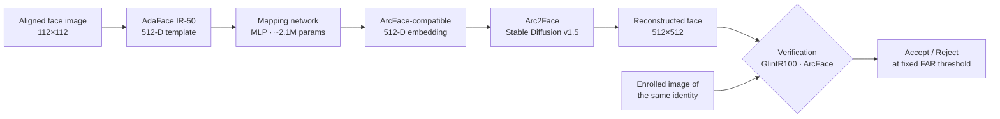
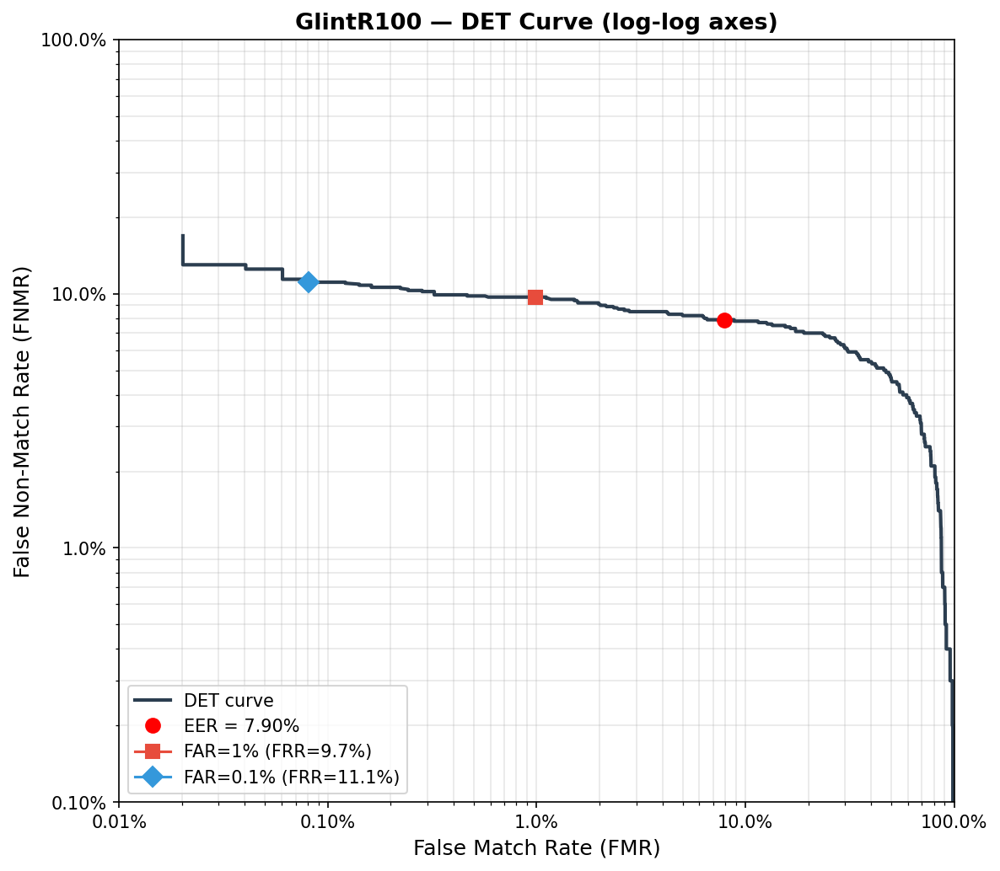
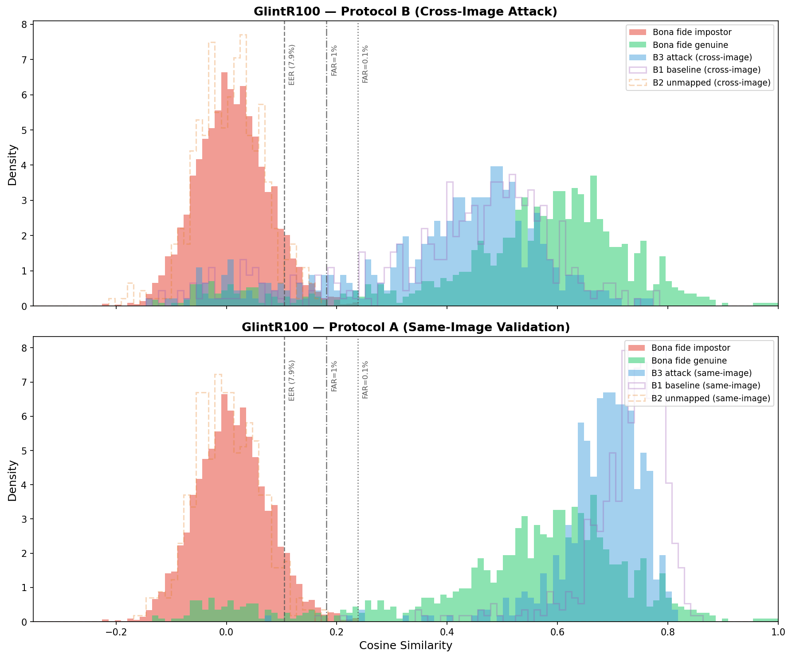

# Emb2Face – Cross-Model Face Embedding Inversion

**Reconstructing recognisable faces from face-recognition embeddings, even when they come from a different model than the face generator expects.**


> [!IMPORTANT]
> This is **academic security research**: an attack evaluation that measures how much identity information face embeddings leak. It was carried out for a university IT-security course, on a public research dataset. Do not use it to reconstruct or identify real people without their consent.

---

## Overview

Face recognition systems store **embeddings** (compact 512-dimensional vectors) as biometric templates. These templates are often assumed to be safe, because they look like meaningless numbers.

Existing inversion attacks usually assume that the attacker's face generator was built for the **same** face-recognition model that produced the stolen template. Emb2Face drops that assumption:

1. A template is extracted with **AdaFace**, the "victim" model.
2. A lightweight **mapping network** translates it into the embedding space of **ArcFace**.
3. **Arc2Face**, a diffusion model conditioned on ArcFace embeddings, reconstructs a photorealistic 512×512 face.
4. The reconstruction is presented to **two independent face-verification systems**, to test whether it is accepted as the genuine person.

**Key result:** at a strict false-accept rate of **0.1%**, about **82%** of reconstructions were accepted as the genuine person, across different images of the same identity. Without the mapping network, **0%** were accepted.

*Sole-author M.Sc. course project, Otto von Guericke University Magdeburg (2026).*

## How it works



### Mapping network

| Component | Setting |
|---|---|
| Architecture | MLP 512 → 1024 → 1024 → 512, BatchNorm, ReLU, dropout 0.1, L2-normalised output |
| Parameters | 2,103,296 (~2.1M) |
| Loss | 0.5 × (1 − cosine similarity) + 0.5 × MSE |
| Optimiser | Adam, lr 1e-3, cosine annealing, batch size 128, 200 epochs |
| Training data | **485,936** paired AdaFace/ArcFace embeddings from **10,472** CASIA-WebFace identities |
| Validation | Identity-disjoint 80/20 split (no identity appears in both sets) |
| Result | Mean validation cosine similarity **0.812** on unseen identities |

A deeper variant was also tested: 3 hidden layers, a residual connection, AdamW, warmup and 500 epochs. It reached a validation cosine of 0.816, a marginal gain, so the simpler model was kept.

### Face generation (Arc2Face)

| Setting | Value |
|---|---|
| Base model | Stable Diffusion v1.5 with Arc2Face UNet and encoder |
| Scheduler | DPMSolverMultistepScheduler, 25 steps, guidance scale 3.0 |
| Seed | 42 (fixed for every reported metric) |
| Precision | float32, CPU inference |

## Evaluation protocol

The evaluation is designed to rule out data leakage:

- **Held-out test set:** 100 identities × 5 images, sampled with a fixed seed. None of these identities was seen during training (checked automatically).
- **Two independent evaluators:** **GlintR100** and an internal **ArcFace** model, both run through ONNX Runtime and kept separate from the reconstruction pipeline.
- **Thresholds set before attack scoring:** decision thresholds (EER, FAR 1%, FAR 0.1%) come from bona fide comparisons only (1,000 genuine and 4,950 impostor pairs). Attack scores are computed only afterwards.
- **Three conditions:**
  - **B1, upper bound:** the real ArcFace embedding → Arc2Face
  - **B2, negative control:** the AdaFace embedding fed directly into Arc2Face, with no mapping
  - **B3, the attack:** AdaFace → mapping network → Arc2Face
- **Two protocols:**
  - **Protocol A (same image, sanity check):** each reconstruction is compared with its own source image.
  - **Protocol B (cross image, main result):** image 0 of each identity is enrolled, and reconstructions from images 1–4 are used as attacks (400 pairs).
- **Metric:** attack success rate, the share of attacks accepted at a given threshold. It is modelled on IAPMR from ISO/IEC 30107-3.

The evaluation runs as a **six-phase pipeline**. Every phase has automatic checks (file integrity, embedding norms, CSV spot checks against saved scores), and all phases pass.

## Results

### Bona fide baseline

| Evaluator | EER | Threshold @ FAR 1% | Threshold @ FAR 0.1% |
|---|---|---|---|
| GlintR100 | 7.90% | 0.1815 | 0.2381 |
| Internal ArcFace | 8.59% | 0.1432 | 0.2186 |

### Attack success rate: Protocol B (cross image, main result)

| Evaluator | B1 upper bound @0.1% | B2 no mapping @0.1% | **B3 attack @0.1%** | B3 attack @1% |
|---|---|---|---|---|
| GlintR100 | 82.8% | 0.0% | **81.8%** | 85.5% |
| Internal ArcFace | 83.5% | 0.0% | **82.2%** | 86.2% |

### Attack success rate: Protocol A (same image)

| Evaluator | B3 attack @1% | B3 attack @0.1% |
|---|---|---|
| GlintR100 | 99.8% | 99.6% |
| Internal ArcFace | 99.8% | 99.6% |

**What this shows**
- Without the mapping network (B2), the attack fails completely. **The learned mapping is what makes the cross-model attack possible.**
- With it (B3), results come within **1.0–1.3 percentage points** of the native-ArcFace upper bound (B1).
- Face embeddings should be treated as **sensitive biometric data**, not as anonymous vectors.

<p align="center">
  
  
</p>

## Tech stack

| Area | Tools |
|---|---|
| Deep learning | PyTorch, Hugging Face Diffusers, Transformers, Stable Diffusion v1.5 |
| Face recognition | AdaFace (IR-50, WebFace4M), ArcFace / GlintR100 (InsightFace antelopev2), ONNX Runtime |
| Data and evaluation | NumPy, SciPy, scikit-learn, Pandas, OpenCV, Pillow |
| Visualisation | Matplotlib, interactive HTML reconstruction dashboards |

## Engineering notes

- **Resumable extraction at scale:** embeddings for ~486k images are extracted in chunks of 10,000 and can resume after an interruption (`--resume`).
- **Direct ONNX preprocessing:** InsightFace's built-in face detector fails on pre-aligned 112×112 crops, so the ArcFace and GlintR100 ONNX models are called directly, with preprocessing matched to each model.
- **Pinned versions for reproducibility:** newer `transformers` releases (5.x) make Arc2Face give **wrong results without any error**. The reconstruction scripts therefore run in a pinned environment (`transformers 4.36.0`, `diffusers 0.29.2`) and stop if the versions don't match.
- **Separate evaluators:** the evaluators (GlintR100, internal ArcFace) are different model files from the ArcFace model used inside Arc2Face.

## Repository structure

```text
.
├── scripts/
│   ├── 04_make_eval_split.py                 # Seeded, identity-disjoint 100-identity test split
│   ├── preprocessing_utils.py                # Image loading + AdaFace / ArcFace / GlintR100 preprocessing
│   ├── 06_extract_embeddings_full.py         # Chunked, resumable embedding extraction (~486k pairs)
│   ├── 06_extract_embeddings_subset.py       # Small subsets for quick experiments
│   ├── 07_train_mapping_network_subset.py    # Mapping-network training (main model)
│   ├── 08_baseline_experiments.py            # B1 / B2 / B3 reconstructions on a small sample
│   ├── 08b … 08e_evaluate_*.py               # Early reconstruction-quality checks
│   ├── 09_ / 09b_arc2face_*diagnostic.py     # Arc2Face environment and reproducibility diagnostics
│   ├── 11_reconstruct_full_official.py       # Full 500-image B1 / B2 / B3 reconstruction
│   ├── 12_ / 15_visualize_*dashboard.py      # Interactive HTML reconstruction dashboards
│   ├── 13_train_mapping_improved.py          # Deeper residual variant (experiment)
│   ├── 18_best_of_3_presentation_subset.py   # Seed selection for presentation images only
│   ├── 19_phase1_verify_inputs.py            # Phase 1: input integrity checks
│   ├── 20_phase2_extract_embeddings.py       # Phase 2: evaluator embeddings
│   ├── 21_phase3_bonafide_scores.py          # Phase 3: genuine/impostor scores, EER, FAR thresholds
│   ├── 22_phase4_attack_scores.py            # Phase 4: Protocol A/B attack scores
│   ├── 23_phase5_validate_results.py         # Phase 5: result validation
│   └── 24_phase6_visualize.py                # Phase 6: DET/ROC curves, score distributions, summary
├── outputs/
│   ├── evaluation/                           # Metrics (CSV/JSON), thresholds, figures, summary
│   └── evaluation/figures/                   # DET/ROC curves and score distributions
├── models/mapping_network/checkpoints/       # Trained mapping-network weights
└── requirements.txt
```

> [!NOTE]
> Datasets, face images (originals and reconstructions), the HTML dashboards that contain them, embeddings and third-party model weights are **not included** in this repository, for size, privacy and licensing reasons.

## Reproducing the results

### 1. Environments
Two Python environments are used:

```bash
# Main environment: data preparation, training, evaluation
pip install torch torchvision --index-url https://download.pytorch.org/whl/cpu
pip install -r requirements.txt
```

```bash
# Arc2Face environment: face reconstruction (pinned versions)
conda create -n arc2face_official python=3.10
conda activate arc2face_official
pip install torch==2.0.1 transformers==4.36.0 diffusers==0.29.2 accelerate safetensors onnxruntime opencv-python-headless
```

### 2. Models and data
Download these from their official sources:

| Asset | Expected path |
|---|---|
| CASIA-WebFace (112×112, aligned) | `data/raw/casia_webface/webface_112x112/` |
| AdaFace IR-50 WebFace4M checkpoint ([AdaFace](https://github.com/mk-minchul/AdaFace)) | `models/adaface/adaface_ir50_webface4m.ckpt` and `models/adaface_repo/` |
| Arc2Face code and weights ([Arc2Face](https://github.com/foivospar/Arc2Face)) | `models/arc2face_repo/` (weights in `arc2face_weights/`) |
| InsightFace antelopev2 (`arcface.onnx`, `glintr100.onnx`) | `models/antelopev2_arc2face/`, `models/antelopev2_eval/` |

### 3. Pipeline

```bash
python scripts/04_make_eval_split.py
python scripts/06_extract_embeddings_full.py --resume
python scripts/07_train_mapping_network_subset.py --data embeddings/train/train_full.npz

conda activate arc2face_official
python scripts/11_reconstruct_full_official.py

python scripts/19_phase1_verify_inputs.py
python scripts/20_phase2_extract_embeddings.py
python scripts/21_phase3_bonafide_scores.py
python scripts/22_phase4_attack_scores.py
python scripts/23_phase5_validate_results.py
python scripts/24_phase6_visualize.py
```

The results are written to `outputs/evaluation/`. The summary is in `biometric_summary.csv`.

## Limitations

- Evaluated on **100 identities** from one dataset (CASIA-WebFace). The attack has not been tested on other datasets or on real deployed systems.
- Thresholds were evaluated down to FAR 0.1%. Real systems often operate at FAR 10⁻⁵ to 10⁻⁶, which remains future work.
- One source model (AdaFace) and one target generator (Arc2Face) were tested.
- Each reconstruction uses a single seed (42). Images shown in presentations were chosen as the best of 3 seeds and are **not** used for any metric.

## Responsible use

This project shows a privacy risk so that it can be defended against, for example by protecting templates or encrypting stored embeddings. Please:
- use it only for research and education;
- respect the licences and terms of use of CASIA-WebFace, AdaFace, Arc2Face, InsightFace and Stable Diffusion;
- never apply it to images or templates of people who have not consented.

## Author

**Nandeesh Bukkambudhi Somanatha**, M.Sc. Digital Engineering, Otto von Guericke University Magdeburg.
Course research project in IT security, 2026. Project report: *Emb2Face: Cross-Model Face Embedding Inversion via Learned Mapping Networks*.
